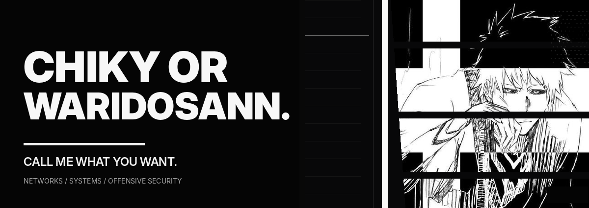
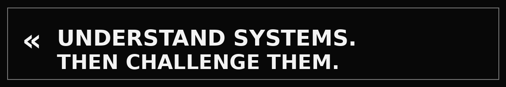
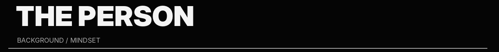
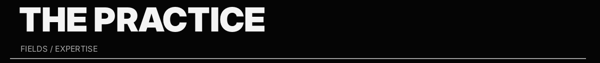
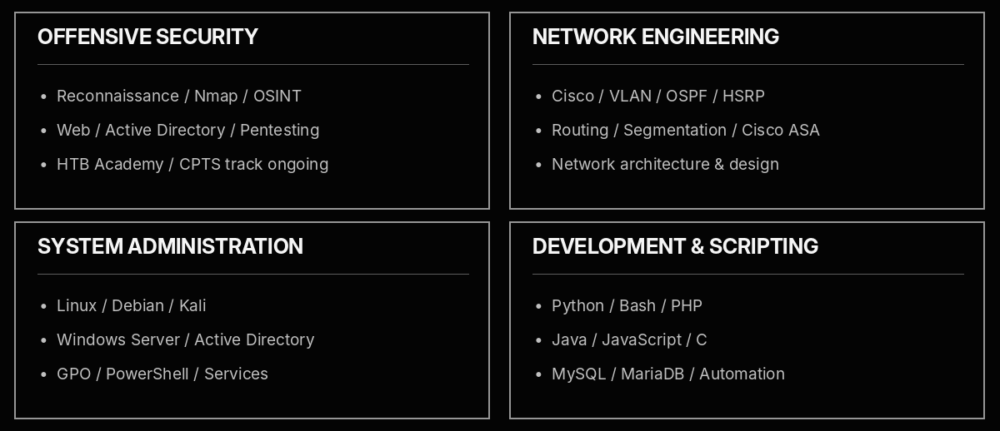
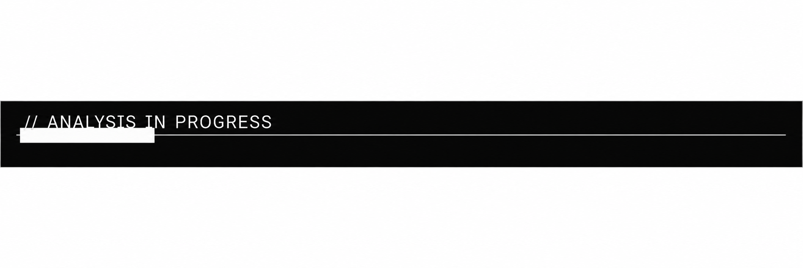

  

 

  

**Chiky** or **[WaridoSann](https://github.com/WaridoSann)** — call me whichever you prefer.

My focus is **network engineering, system administration and offensive security**. I enjoy understanding how infrastructure works — from protocols and operating systems to web applications — before testing its security.

I learn by building labs, developing practical tools and documenting what I discover.

**Currently:** studying Networks & Telecommunications with a cybersecurity specialization, while working through **Hack The Box Academy's Penetration Tester (CPTS) path**. *The CPTS certification is not yet completed.*

  

My toolkit includes **Nmap, Metasploit, Cisco IOS, Cisco ASA, Debian, Kali Linux, Windows Server, Active Directory, PowerShell, Python, Bash, PHP, Java, JavaScript, C and MySQL/MariaDB**.

*All offensive security testing is conducted in CTFs, dedicated labs or explicitly authorized environments.*

**[GITHUB](https://github.com/WaridoSann)** &nbsp; / &nbsp; **[PORTFOLIO](https://WaridoSann.github.io/)** &nbsp; / &nbsp; **ROOT-ME: `wyyyz`** &nbsp; / &nbsp; **HACK THE BOX ACADEMY**

 

 

